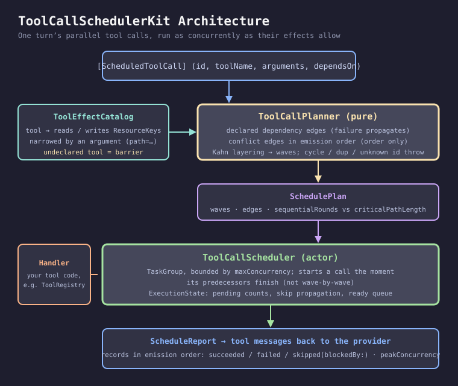
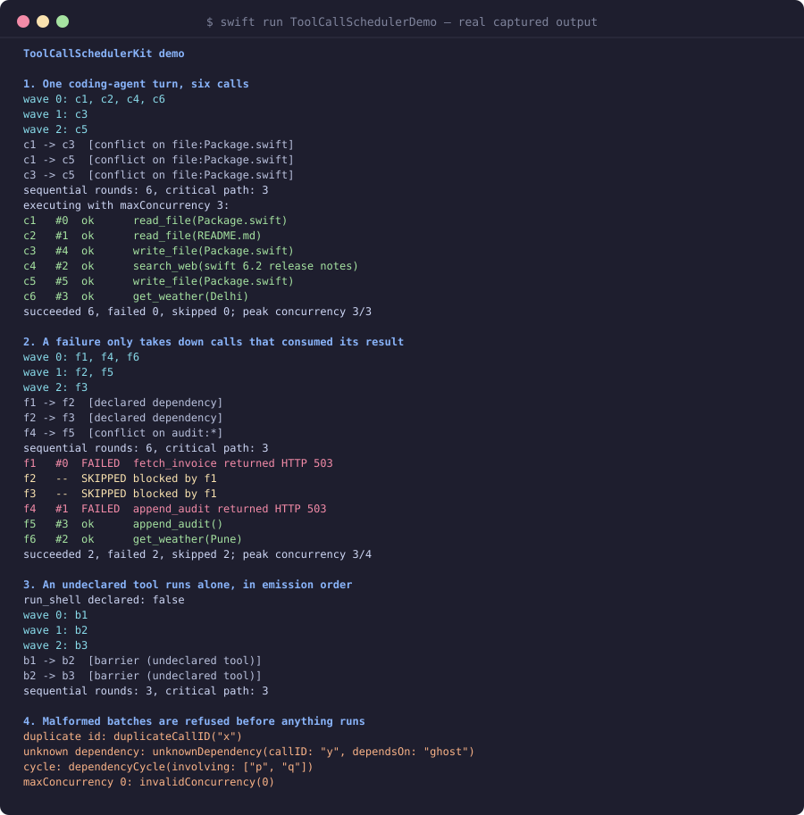
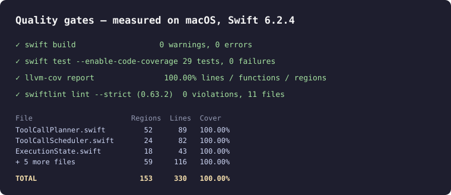

# ToolCallSchedulerKit

Run one turn's **parallel tool calls** as concurrently as their declared effects allow, and no
more. Two calls that write the same file never overlap. Calls that only read, or touch different
things, run together. A failure takes down only the calls that consumed its result. Results come
back in emission order, ready to return to the provider.

Part of the Swift LLM ecosystem around
[`ProviderGatewayKit`](https://github.com/rajatslakhina/foundation-model-provider-gateway). It
pairs with [`ToolRegistryKit`](https://github.com/rajatslakhina/tool-registry-kit) (which
dispatches *one* call) and [`StreamAggregatorKit`](https://github.com/rajatslakhina/stream-aggregator-kit)
(which reassembles a batch of streamed calls).



## The problem

Every major provider lets a model emit several tool calls in one turn. The client then has two
easy options, and both are wrong in a different way:

- **Run them one at a time.** Safe, and slow: six calls that each take a second cost six seconds
  even when four of them are unrelated lookups.
- **Run them all at once.** Fast, and occasionally corrupting: a model that emits
  `read_file(Package.swift)`, `write_file(Package.swift)`, `write_file(Package.swift)` in one turn
  meant them in that order. Racing them gives you whichever write lands last and a read that may
  or may not see either.

The model's emission order is the only ordering signal you usually get. Providers have no field
for "call 3 needs call 1's result". So the scheduler needs something else to know which calls
are allowed to overlap, and that something is a declaration of what each tool touches.

## How it works

**Declare effects once, per tool.** A `ToolEffectCatalog` maps a tool name to the resources it
reads and writes. A `ResourceSelector` can narrow a resource by one argument, so
`write_file(path: "a")` and `write_file(path: "b")` don't conflict but two writes to `a` do. If
the argument is missing, the key is unnarrowed and conflicts with every instance: the
conservative reading.

**Undeclared tools are barriers.** A tool with no rule might do anything, so it runs alone, in
emission order relative to every other call in the batch. That is the slow answer on purpose.

**Two kinds of edge, with different failure semantics.**

| Edge | Comes from | Order kept? | Failure propagates? |
|------|-----------|-------------|---------------------|
| `.dependency` | `ScheduledToolCall.dependsOn` | yes | **yes**: dependents are `skipped(blockedBy:)` |
| `.resourceConflict([keys])` | read/write, write/read or write/write overlap | yes (emission order) | **no**: the later call never needed the earlier one's output |
| `.barrier` | an undeclared tool on either side | yes | no |

That split matters. If the first of two `append_audit` calls fails, the second one should still
run; it only had to wait for the write slot. If `fetch_invoice` fails, `summarize(invoice)` has
nothing to summarize and must not run.

**A plan you can inspect before anything runs.** `ToolCallPlanner.plan(_:catalog:)` is pure. It
refuses a malformed batch up front (duplicate call ids, a dependency on an id that isn't in the
batch, a dependency cycle) and otherwise returns waves, edges, `sequentialRounds` and
`criticalPathLength`.

**An executor that doesn't wait for whole waves.** `ToolCallScheduler.execute(_:handler:)` starts
each call the moment its predecessors are done and a slot under `maxConcurrency` is free. Waves
describe the plan's shape, not its timetable.

## Demo

`swift run ToolCallSchedulerDemo` runs four scenarios. This is its real output, captured on this
Mac (also in `Screenshots/demo-output.txt`):



1. A six-call coding-agent turn: two reads, a web search and a weather lookup run together; the
   two `write_file(Package.swift)` calls go after the read of the same file, in emission order.
   Six sequential rounds become a critical path of three.
2. `fetch_invoice` fails and takes `summarize` and `send_email` down with it, both blamed on the
   root failure. The first `append_audit` also fails; the second one still runs.
3. An undeclared `run_shell` splits the batch into three single-call waves.
4. A duplicate id, an unknown dependency, a cycle and `maxConcurrency: 0` are refused before
   anything runs.

## Usage

```swift
import ToolCallSchedulerKit

let catalog = ToolEffectCatalog([
    "read_file": ToolEffectRule(reads: [ResourceSelector("file", instanceArgument: "path")]),
    "write_file": ToolEffectRule(writes: [ResourceSelector("file", instanceArgument: "path")]),
    "search_web": .pure
])

let scheduler = try ToolCallScheduler(catalog: catalog, maxConcurrency: 4)

// Map your provider's tool calls into ScheduledToolCall (id, name, flattened arguments).
let report = try await scheduler.execute(calls) { call in
    try await registry.run(call)          // your tool code
}

for record in report.records {            // emission order
    switch record.outcome {
    case .succeeded(let output): sendToolMessage(id: record.call.id, content: output)
    case .failed(let message): sendToolMessage(id: record.call.id, content: "error: \(message)")
    case .skipped(let blocker): sendToolMessage(id: record.call.id, content: "not run: \(blocker) failed")
    }
}
```

Every call gets a record, including skipped ones, because providers expect one tool message per
call id.

## Install

```swift
.package(url: "https://github.com/rajatslakhina/tool-call-scheduler-kit.git", from: "1.0.0")
```

Swift tools 5.10 with `StrictConcurrency` enabled; builds clean under the Swift 6.2 toolchain.
No dependencies. macOS 13, iOS 16, tvOS 16, watchOS 9.

## What it does not do

- It cannot infer effects. A wrong declaration gives a wrong schedule. Leaving a tool
  undeclared is always safe, just slower.
- It does not retry. Pair it with `RetryPolicyKit` inside the handler if you want retries.
- It does not cancel in-flight siblings when one call fails. Independent calls are meant to
  finish; cancelling them would waste work the model asked for.

## Quality



- `swift build`: 0 warnings, 0 errors.
- `swift test --enable-code-coverage`: 29 tests, 0 failures. One test drives a 12-call batch
  through an actor that records how many calls touch each file at once and asserts writes to one
  file never overlap.
- `llvm-cov report`: 100.00% lines, functions and regions on every library file.
- `swiftlint lint --strict` (0.63.2, run for real): 0 violations.

## License

MIT
